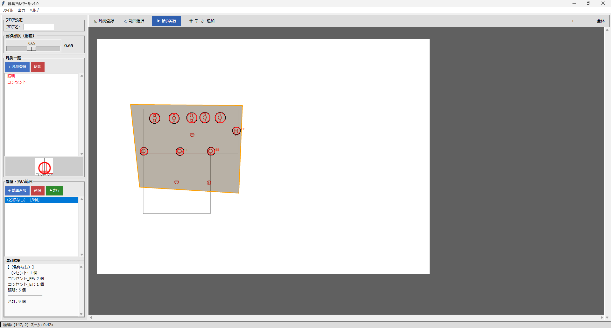
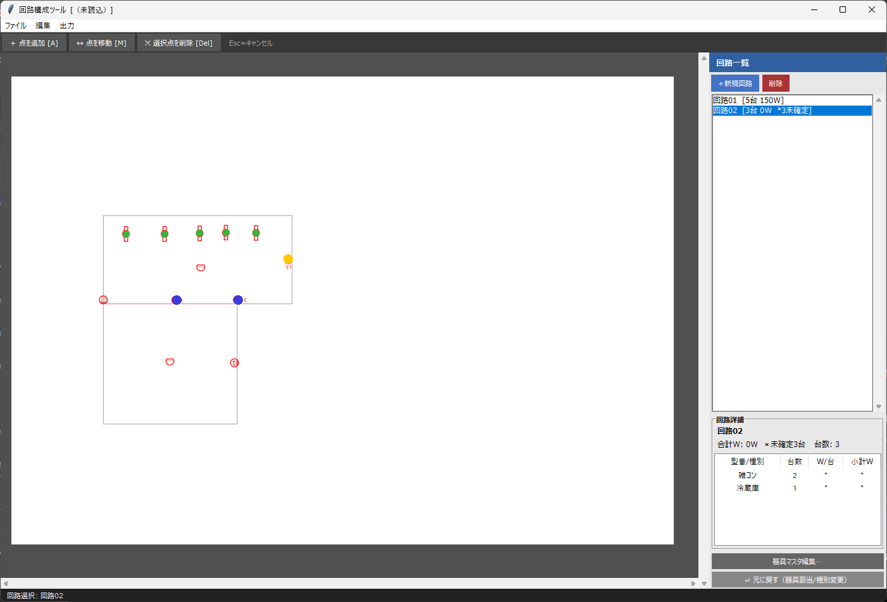

# 自己紹介

電気設備設計に携わっています。プログラミングは未経験で、現場の手作業を楽にするため、AIとの対話でツールを作っています（コードは自分では書いていません）。

## 作ったもの

### 器具拾いツール
照明設備図のPDFから、器具の記号を自動で見つけて数えるWindowsアプリです。

印刷した図面にチェックを入れながら器具を数える作業を、次の流れに置き換えました。
凡例として器具記号を登録 → 数える範囲（部屋）を指定 → 拾いを実行 → 誤検出・漏れを修正 → CSV／マーカー付きPDFで出力

- テンプレートマッチングによる認識（感度は調整できます）
- 図面データは外部に送信されず、完全にローカルで動作します
- 前提：器具記号が赤色、下地がモノクロで色分けされた図面

### 回路構成ツール
PDF図面を背景に、器具の点を置き、回路に割り当てるWindowsアプリです。

- 回路ごとの色分け、合計W・台数の表示
- 種別やW数が未設定の器具は「未確定」として別に表示
- 器具マスタ（CSVの取り込み・書き出し）
- 回路一覧・集計・未確定器具のCSV出力、元に戻す操作

## 使っている技術
Python / OpenCV / PyMuPDF
